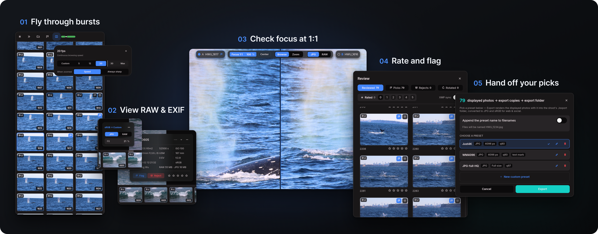

[简体中文](README.md) | **English**

# Falcon Photo Viewer

Find the moments worth keeping in a day's worth of bursts. Falcon brings fast browsing, focus inspection, comparison and hand-off into one desktop culling tool.

## See the motion, then inspect the detail

Hold an arrow key to follow a wingbeat, stride or changing expression. Stop on a frame to inspect full-resolution detail, then click the point you want to check at 1:1.

## Compare photographs, not duplicate files

A shot's RAW and JPEG form one culling unit, so the same moment needs only one decision. In two-photo comparison, zoom and pan stay linked. Pin a favorite and step through challengers beside it.

## Hand your picks to an editor

Rate, pick and reject, then copy originals without re-encoding or export sRGB JPG/PNG copies for sharing. Open folders directly without importing a catalogue, using shortcuts or right-click menus for common actions.

Falcon focuses on viewing and culling; exposure, white balance and full editing remain with your photo editor.

## Try it

[Download for Windows / Apple Silicon Mac](https://github.com/HWu0101/falcon-photo-viewer/releases)

See the [user guide](docs/GUIDE.en.md) for system requirements, first-launch prompts, supported formats and shortcuts.

## Explore further

| Topic | Documentation |
| --- | --- |
| Downloads, requirements and culling controls | [User guide](docs/GUIDE.en.md) |
| Design decisions and detailed features | [Original author's design reference](docs/readme-reference.en.md) |
| Source builds and architecture | [Build guide](BUILDING.md) · [Architecture](logic.md) |
| Contributions | [Contributing](CONTRIBUTING.md) · [Issues in this fork](https://github.com/DrivingGodJ/falcon-photo-viewer/issues) |

Originally designed by **Hancheng Wu**. This repository is a fork of [HWu0101/falcon-photo-viewer](https://github.com/HWu0101/falcon-photo-viewer), developed with assistance from Claude and Codex. [Apache-2.0](LICENSE) · [NOTICE](NOTICE) · [Third-party terms](THIRD-PARTY-NOTICES.txt)

