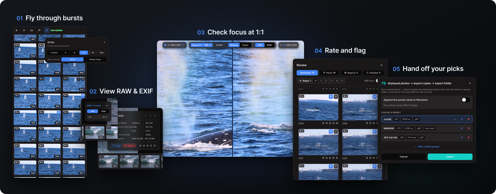

**简体中文** | [English](README.en.md)

# Falcon Photo Viewer

从一整天的连拍里，挑出值得留下的瞬间。Falcon 把快速浏览、焦点检查、双图比较和选片交付放在同一个桌面工具里。

## 先看动作，再看细节

按住方向键浏览连续画面，观察鸟翼、步伐或表情的变化；停下来时，再查看全分辨率细节。单击想检查的位置进入 1:1，判断焦点是否落在需要的地方。

## 比较的是照片，不是文件

同一次拍摄的 RAW 与 JPEG 合成一个选片单位，不必把同一个瞬间判断两遍。打开双图比较后，两侧同步缩放和平移；固定喜欢的一张，再逐张寻找更好的候选。

## 让选中的照片进入后期

用星级、选中和拒绝整理结果，再复制未经重编码的原片，或导出适合分享的 sRGB JPG/PNG。文件夹直接打开，无需先建立图库；快捷键与右键菜单都能完成常用操作。

Falcon 专注看图与选片，曝光、白平衡和完整修图继续交给后期软件。

## 开始体验

[下载 Windows / Apple Silicon Mac 发行版](https://github.com/HWu0101/falcon-photo-viewer/releases)

安装要求、首次启动提示、支持格式和快捷键，见[使用指南](docs/GUIDE.zh-CN.md)。

## 进一步了解

| 想了解什么 | 去哪里看 |
| --- | --- |
| 下载、系统要求与选片操作 | [使用指南](docs/GUIDE.zh-CN.md) |
| 设计思考与详细功能 | [原作者设计参考（英文）](docs/readme-reference.en.md) |
| 源码构建与技术架构 | [构建指南](BUILDING.md) · [架构](logic.md) |
| 参与协作 | [贡献指南](CONTRIBUTING.md) · [本 fork 的 Issues](https://github.com/DrivingGodJ/falcon-photo-viewer/issues) |

原作由 **Hancheng Wu** 设计，本仓库为 [HWu0101/falcon-photo-viewer](https://github.com/HWu0101/falcon-photo-viewer) 的 fork。开发获得 Claude 与 Codex 辅助。[Apache-2.0](LICENSE) · [NOTICE](NOTICE) · [第三方许可](THIRD-PARTY-NOTICES.txt)

